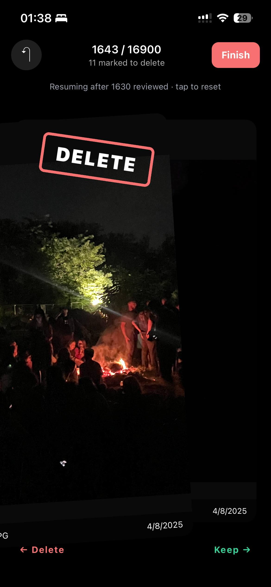
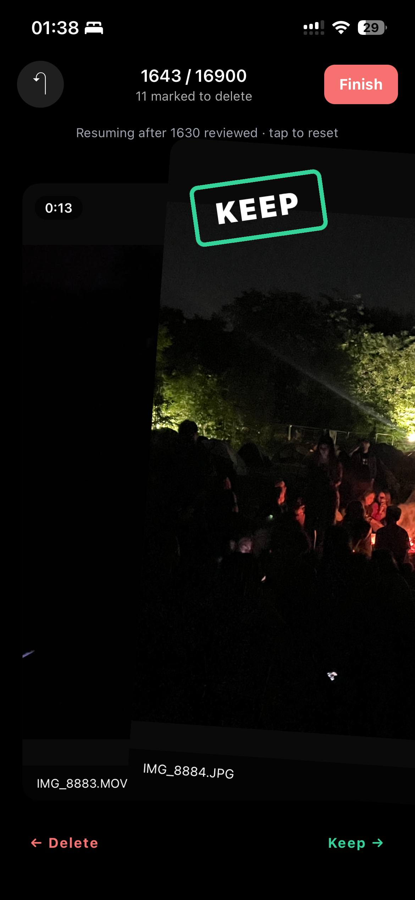

# PhotosCleaner

A personal iPhone app for cleaning up an overgrown camera roll using a Tinder-style swipe deck. Swipe left to mark for deletion, right to keep. Decisions persist across sessions, and a single batch delete at the end finishes the job.

Built with React Native + Expo. Runs inside Expo Go for development, or as a standalone app installed with a free Apple ID — no paid Apple Developer account required.

## Screenshots

<p align="center">
  
  
</p>

## Quick start

**Prerequisites:** Node.js 20+, an iPhone on the same Wi-Fi, the free **Expo Go** app from the App Store.

```powershell
npm install
npx expo start --go
```

Scan the QR code with the iPhone Camera app to open it in Expo Go, then grant **Full Photo Library** access on first run. The `--go` flag is needed because `expo-dev-client` is installed; without it the QR code targets a development build instead of Expo Go.

If you see `[runtime not ready]` or module-resolution errors after a dependency change, restart with `npx expo start --go --clear`.

## Install as a standalone app (free Apple ID, Windows)

A GitHub Actions workflow (`.github/workflows/ios-unsigned-ipa.yml`) builds an **unsigned Release `.ipa`** on every push (docs-only changes are skipped), or on demand from **Actions → Build unsigned iOS .ipa → Run workflow**. The JS bundle is embedded, so the app opens from the home screen with no computer, Wi-Fi or Expo Go.

1. Open the latest successful run in the **Actions** tab, download the **PhotosCleaner-ipa** artifact and unzip it to get `PhotosCleaner.ipa`.
2. On Windows install [iTunes](https://www.apple.com/itunes/) (the version from apple.com, not the Microsoft Store) and [Sideloadly](https://sideloadly.io/).
3. Connect the iPhone by USB and tap **Trust** on the phone.
4. In Sideloadly drop in the `.ipa`, enter your Apple ID, and click **Start**. The free Apple ID is used only to sign the app.
5. On the iPhone:
   - **Settings → General → VPN & Device Management** → trust your Apple ID's developer profile.
   - **Settings → Privacy & Security → Developer Mode** → on (the phone restarts).
6. Open PhotosCleaner and grant **Full Photo Library** access.

**Limits of a free Apple ID:** the signature expires after **7 days**. The app then stops launching until you re-sign it: run Sideloadly again with the same `.ipa`. Reinstalling over the existing app keeps your saved decisions. At most 3 sideloaded apps can be active at once.

To install a newer build, push your changes, wait for the workflow to finish (~15–20 min), and sideload the new `.ipa` the same way.

## Features

- **Swipe deck** — stacked-card UI, left to delete / right to keep, with undo.
- **Photos and videos** — inline video playback with tap-to-pause and replay.
- **Pinch-to-zoom** — Instagram-style focal zoom; drag with two fingers to pan.
- **Persistent progress** — decisions saved across sessions; the deck auto-skips items you've already reviewed.
- **Batch delete** — one iOS confirmation at the end, with the option to deselect items before deletion.

## Tech stack

- **Expo SDK 57** managed workflow
- **TypeScript** end-to-end
- **expo-media-library** — camera-roll access and batch delete
- **expo-image**, **expo-video**, **expo-video-thumbnails** — media rendering
- **expo-file-system** — sandbox copy fallback for restricted video paths
- **react-native-reanimated 4** + **react-native-gesture-handler** — gestures and animations
- **@react-native-async-storage/async-storage** — decision persistence
